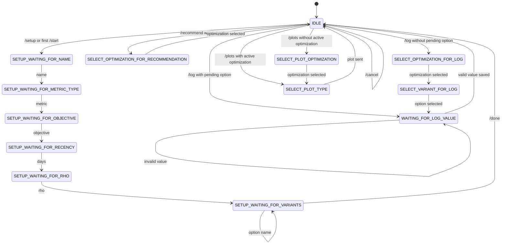

# Telegram Bot MVP For Daily Bandit Decisions

This document describes a small Telegram bot MVP based on the
`trips_optimization.ipynb` workflow. The goal is to make the notebook's
mean-variance bandit capability usable as a daily interaction:

1. Set up a decision problem.
2. Ask what to choose next.
3. Log the result after the event.
4. Receive an updated recommendation and simple plots.

The MVP should be simple to implement on top of the current bot structure:
`aiogram` handlers, FSM states, SQLite persistence, and `mvsampling.HandsTable`.

## Product Shape

The bot helps one user repeatedly choose among a fixed set of options for a
numeric outcome.

Example:

- Decision: `Morning commute`
- Options: `moped`, `motorcycle`, `MCK`
- Metric: travel time in minutes or `hh:mm:ss`
- Objective: minimize
- Recency window: last 360 days relative to the latest logged event
- Recommendation: the option ranked first by `HandsTable.grade()`

The bot should rebuild a fresh `HandsTable` from database samples whenever it
needs a recommendation. This keeps the implementation compatible with the
notebook assumption that `process_events()` is not idempotent.

## MVP Scope

### In Scope

- Greeting and help.
- Setup wizard for a numeric optimization.
- One active optimization per user for quick daily use.
- Add, list, and remove options.
- Manual daily recommendation.
- Manual result logging.
- Immediate updated recommendation after logging.
- Static Telegram plots:
  - option probability bar chart;
  - value distribution by option;
  - recent logged values over time.

### Out Of Scope

- Yes/no optimizations.
- Multiple metrics per event.
- Automatic route-specific logic like morning/evening split.
- Full notebook parity with Plotly interactivity.
- Editing old samples through Telegram.
- Idempotent `process_events()` behavior.
- Complex reminders. A daily reminder can be added later after the manual loop
  works well.

## User Commands

### `/start`

Purpose: greet the user and route them to setup or recommendation.

Behavior:

- If the user has no optimizations, show a short welcome message and a
  `Create setup` button.
- If the user has one active optimization, show the latest recommendation.
- If the user has optimizations but no active optimization, ask them to pick one.

Suggested text:

```text
Hi. I can help you choose what to try next and learn from the result.
Let's set up your first daily decision.
```

### `/setup`

Purpose: create a new optimization.

Collect:

- optimization name;
- metric type: time or number;
- objective: minimize or maximize;
- recency window in days, default `360`;
- risk tolerance `rho`, default `1.0` for commute-style decisions;
- option names.

The MVP should hide advanced language. For `rho`, use a default and offer a
`Use default` button. The user does not need to understand the paper formula to
get value from the bot.

### `/recommend`

Purpose: show what to choose next.

Behavior:

- Use the active optimization if one exists.
- If not, ask the user to choose an optimization.
- Build a fresh `HandsTable` from the optimization's samples.
- Apply the recency window relative to `max(sample.change_datetime)`.
- Return:
  - best option;
  - compact table of ranked options;
  - action buttons.

Suggested buttons:

- `Log this result`
- `I chose another option`
- `Plots`
- `Settings`

Suggested response:

```text
For Morning commute, choose next:

motorcycle

Current ranking:
option       n   mean   risk95
motorcycle  3   71.8   76.7
moped       1   101.4  103.5
MCK         4   97.7   111.1
```

### `/log`

Purpose: log one completed event.

Behavior:

- If there is a pending recommendation, preselect that option and ask for the
  result.
- Otherwise ask the user to choose optimization and option.
- Ask for the observed value.
- Accept:
  - `hh:mm:ss`;
  - `h:mm:ss`;
  - decimal number, interpreted according to the optimization metric.
- Store the value in normalized numeric form. For time metrics, store minutes.
- Rebuild the recommendation and show the new best option.

Suggested response after logging:

```text
Saved: motorcycle = 00:35:30.

Updated next recommendation:
motorcycle
```

### `/plots`

Purpose: send static visual feedback.

Behavior:

- Ask for optimization if needed.
- Let user choose plot type or send all MVP plots.
- Render with `matplotlib`/`seaborn` to PNG and send images.

MVP plot types:

- `Probability`: run `grade()` repeatedly, count the first-ranked option, and
  plot probabilities. Use `1000` simulations for Telegram responsiveness.
- `Distribution`: violin or box plot of observed values by option.
- `Timeline`: scatter or line plot of logged values by date, colored by option.

### `/settings`

Purpose: view and lightly edit the active optimization.

MVP settings:

- active optimization;
- objective;
- recency window;
- `rho`;
- option list.

### `/cancel`

Purpose: exit the current FSM flow and return to idle.

## Main Daily Interaction

The desired daily loop is:

1. User opens the bot and says `hi`, presses `/start`, or sends `/recommend`.
2. Bot shows the recommendation for the active optimization.
3. User follows the recommendation or chooses a different option.
4. After the event, user presses `Log this result` or sends `/log`.
5. Bot asks for the measured value.
6. User enters `00:35:30`.
7. Bot saves the sample, rebuilds the bandit table, and shows the updated next
   recommendation.
8. User can press `Plots` to see current evidence.

Free-text greetings like `hi`, `hello`, and `what should I choose?` can be
treated as aliases for `/recommend` when the user is not inside another FSM
state.

## Setup Interaction

Example setup flow:

```text
User: /setup
Bot: What decision do you want to optimize?
User: Morning commute

Bot: What kind of result will you log?
[Time] [Number]
User taps: Time

Bot: Do lower or higher values mean better?
[Lower is better] [Higher is better]
User taps: Lower is better

Bot: How many days of history should I use?
[360 days] [180 days] [90 days] [Custom]
User taps: 360 days

Bot: Risk tolerance?
[Use default] [Custom]
User taps: Use default

Bot: Add options one by one. Send /done when finished.
User: moped
Bot: Added moped. Send another option or /done.
User: motorcycle
Bot: Added motorcycle. Send another option or /done.
User: MCK
Bot: Added MCK. Send another option or /done.
User: /done

Bot: Setup complete. Your active optimization is Morning commute.
Bot: I need observations before recommendations become useful. You can log an
old result now or ask for a recommendation.
[Log old result] [Recommend]
```

## Finite State Machine

### State List

`IDLE`

Default state. User can start setup, ask for a recommendation, log a result, or
request plots.

`SETUP_WAITING_FOR_NAME`

Bot is waiting for the optimization name.

`SETUP_WAITING_FOR_METRIC_TYPE`

Bot is waiting for metric type selection: `time` or `number`.

`SETUP_WAITING_FOR_OBJECTIVE`

Bot is waiting for objective selection: `minimize` or `maximize`.

`SETUP_WAITING_FOR_RECENCY`

Bot is waiting for recency window selection or custom day count.

`SETUP_WAITING_FOR_RHO`

Bot is waiting for risk tolerance selection or custom numeric value.

`SETUP_WAITING_FOR_VARIANTS`

Bot accepts option names until `/done`.

`SELECT_OPTIMIZATION_FOR_RECOMMENDATION`

User has requested a recommendation but has no active optimization, or has
chosen to switch optimization.

`SELECT_OPTIMIZATION_FOR_LOG`

User has started logging and must choose which optimization the sample belongs
to.

`SELECT_VARIANT_FOR_LOG`

User has chosen the optimization and must choose the option used.

`WAITING_FOR_LOG_VALUE`

Bot is waiting for the observed numeric or time value.

`SELECT_PLOT_OPTIMIZATION`

User requested plots and must choose an optimization.

`SELECT_PLOT_TYPE`

User must choose one plot or `All plots`.

`EDIT_SETTINGS`

User is editing lightweight optimization settings.

### Transition Table

| Current state | Trigger | Next state | Bot action |
| --- | --- | --- | --- |
| `IDLE` | `/start` with no optimization | `SETUP_WAITING_FOR_NAME` | Greet and start setup |
| `IDLE` | `/start`, `hi`, `/recommend` with active optimization | `IDLE` | Show recommendation |
| `IDLE` | `/setup` | `SETUP_WAITING_FOR_NAME` | Ask for optimization name |
| `SETUP_WAITING_FOR_NAME` | text | `SETUP_WAITING_FOR_METRIC_TYPE` | Save name, ask metric type |
| `SETUP_WAITING_FOR_METRIC_TYPE` | metric callback | `SETUP_WAITING_FOR_OBJECTIVE` | Save metric, ask objective |
| `SETUP_WAITING_FOR_OBJECTIVE` | objective callback | `SETUP_WAITING_FOR_RECENCY` | Save objective, ask recency |
| `SETUP_WAITING_FOR_RECENCY` | recency callback or number | `SETUP_WAITING_FOR_RHO` | Save recency, ask rho |
| `SETUP_WAITING_FOR_RHO` | rho callback or number | `SETUP_WAITING_FOR_VARIANTS` | Create optimization, ask variants |
| `SETUP_WAITING_FOR_VARIANTS` | option text | `SETUP_WAITING_FOR_VARIANTS` | Add option, ask for another |
| `SETUP_WAITING_FOR_VARIANTS` | `/done` | `IDLE` | Mark optimization active |
| `IDLE` | `/recommend` without active optimization | `SELECT_OPTIMIZATION_FOR_RECOMMENDATION` | Ask optimization |
| `SELECT_OPTIMIZATION_FOR_RECOMMENDATION` | optimization callback | `IDLE` | Save active optimization, show recommendation |
| `IDLE` | `/log` with pending recommendation | `WAITING_FOR_LOG_VALUE` | Ask value for pending option |
| `IDLE` | `/log` without pending recommendation | `SELECT_OPTIMIZATION_FOR_LOG` | Ask optimization |
| `SELECT_OPTIMIZATION_FOR_LOG` | optimization callback | `SELECT_VARIANT_FOR_LOG` | Ask option |
| `SELECT_VARIANT_FOR_LOG` | option callback | `WAITING_FOR_LOG_VALUE` | Ask observed value |
| `WAITING_FOR_LOG_VALUE` | valid value | `IDLE` | Save sample, show updated recommendation |
| `WAITING_FOR_LOG_VALUE` | invalid value | `WAITING_FOR_LOG_VALUE` | Explain accepted formats |
| `IDLE` | `/plots` with active optimization | `SELECT_PLOT_TYPE` | Ask plot type |
| `IDLE` | `/plots` without active optimization | `SELECT_PLOT_OPTIMIZATION` | Ask optimization |
| `SELECT_PLOT_OPTIMIZATION` | optimization callback | `SELECT_PLOT_TYPE` | Ask plot type |
| `SELECT_PLOT_TYPE` | plot callback | `IDLE` | Render and send plot(s) |
| any state | `/cancel` | `IDLE` | Clear FSM state |

### Mermaid Sketch



## Data Model

The current tables already cover users, optimizations, variants, and samples.
The MVP needs a small amount of optimization configuration.

Recommended minimal additions:

### `user_settings`

```sql
CREATE TABLE IF NOT EXISTS user_settings (
    telegram_user_id INTEGER PRIMARY KEY,
    active_optimization_id INTEGER,
    FOREIGN KEY (telegram_user_id) REFERENCES users(telegram_user_id) ON DELETE CASCADE,
    FOREIGN KEY (active_optimization_id) REFERENCES user_optimization(id) ON DELETE SET NULL
);
```

### Add columns to `user_optimization`

```sql
ALTER TABLE user_optimization ADD COLUMN metric_type TEXT DEFAULT 'number';
ALTER TABLE user_optimization ADD COLUMN objective TEXT DEFAULT 'minimize';
ALTER TABLE user_optimization ADD COLUMN recency_days INTEGER DEFAULT 360;
ALTER TABLE user_optimization ADD COLUMN rho REAL DEFAULT 1.0;
```

Allowed values:

- `metric_type`: `time`, `number`
- `objective`: `minimize`, `maximize`

### `pending_recommendation`

This can be either a table or FSM data. A table is more robust because the user
may come back hours later to log the result.

```sql
CREATE TABLE IF NOT EXISTS pending_recommendation (
    telegram_user_id INTEGER PRIMARY KEY,
    optimization_id INTEGER NOT NULL,
    variant_id INTEGER NOT NULL,
    recommended_at TEXT DEFAULT (datetime('now')),
    FOREIGN KEY (telegram_user_id) REFERENCES users(telegram_user_id) ON DELETE CASCADE,
    FOREIGN KEY (optimization_id) REFERENCES user_optimization(id) ON DELETE CASCADE,
    FOREIGN KEY (variant_id) REFERENCES optimization_variant(id) ON DELETE CASCADE
);
```

## Recommendation Algorithm

For each recommendation request:

1. Load optimization config.
2. Load variants.
3. Load samples for the optimization.
4. Convert sample values:
   - time samples are already stored as minutes;
   - number samples are stored as floats.
5. Build events:

```python
events[change_datetime] = (variant_name, option_value)
```

6. Create a fresh table:

```python
table = HandsTable(
    options_list=variant_names,
    minimize=(objective == "minimize"),
    rho=rho,
)
```

7. Call:

```python
result = table.process_events(events, days=recency_days)
```

8. The best option is `result.iloc[0]["name"]`.
9. Save that option as the pending recommendation.

Important: do not reuse the same `HandsTable` instance across recommendation
requests. The notebook-style `process_events()` appends observations to the
table and is intentionally not idempotent.

## Plot Generation

Telegram should receive static PNGs, not interactive Plotly charts.

### Probability Plot

- Build a fresh table from events.
- Run `grade()` `1000` times.
- Count `result.iloc[0]["name"]`.
- Send a bar chart of first-place probability by option.

### Distribution Plot

- Load samples.
- Use `seaborn.violinplot()` or `seaborn.boxplot()`.
- X axis: option.
- Y axis: observed value.
- For time metrics, label Y axis as minutes.

### Timeline Plot

- Load samples.
- X axis: `change_datetime`.
- Y axis: observed value.
- Color by option.
- This helps the user see whether recent conditions changed.

## Implementation Order

1. Add config fields to the database.
2. Add user active optimization storage.
3. Split the current `/add_observation` behavior into:
   - `/recommend`;
   - `/log`.
4. Add the setup wizard states.
5. Add value parsing helpers for time and numeric metrics.
6. Add pending recommendation storage.
7. Add static plot rendering and Telegram image sending.
8. Add tests for:
   - setup state transitions;
   - time parsing;
   - recommendation rebuild from database samples;
   - logging with and without pending recommendation;
   - recency window anchored to latest sample date.

## MVP Acceptance Criteria

- A new user can create one optimization without typing command names beyond
  `/setup` and `/done`.
- The user can ask `hi` or `/recommend` and get a clear next action.
- The user can log one result in under three messages.
- After logging, the bot immediately shows the updated best option.
- The bot can send at least one probability plot and one distribution plot.
- Repeated recommendations do not double-count samples.
- The recency window is relative to the latest logged sample, not wall-clock
  today.
